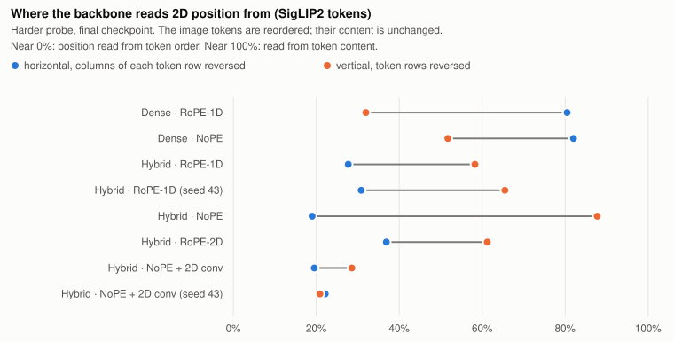
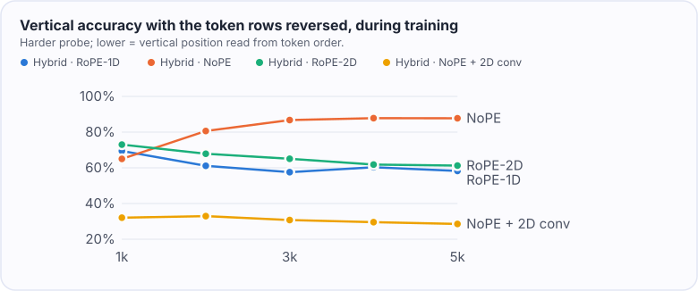
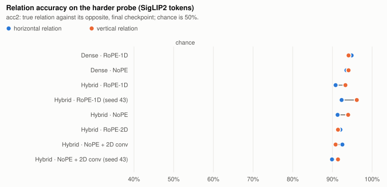

# NextTransformer-V

A prototype multimodal track for [NextTransformer](https://github.com/Interactive-Active-AI/NextTransformer): the same
contract of fixed data, fixed data order and matched training compute, applied to sequences that interleave image tokens
with text at an 8,192-token context.

Its first study asks where a hybrid backbone (Gated DeltaNet layers with a few attention layers) gets the 2D position of
image tokens, and whether making its linear mixing 2D-aware helps. It was pre-registered before the runs started
([pre-registration](docs/spatial-preregistration.md), [addendum](docs/spatial-addendum.md)).

**Status (2026-11-04).** Finished: the diagnostic grid, both seed pairs and the two pre-registered 2D-convolution
comparisons with SigLIP2 tokens. Running: the raw-pixel replication and more raw-pixel runs. This page is updated as
they finish. Every number below comes from the files in [`results/`](results/), and the tables are generated from
them ([`results/tables.md`](results/tables.md)).

## The 2D-position study

Every run has the same budget: 5,000 updates of 128 rows x 8,192 tokens (5.24B tokens), 12 images per row, and
training FLOPs per token within 1% of the Dense anchor. Models have 1.4–1.6B parameters. The runs differ in three
things:

- **Backbone:** Dense, or the GDN hybrid, where three of every four layers are GDN.
- **Attention position encoding:** RoPE-1D over the flattened sequence, NoPE, or RoPE-2D.
- **2D short convolution:** with or without a 3 x 3 depthwise convolution over each image's token grid, replacing the
  1D short convolution of the linear layers at image positions.

Image tokens are frozen SigLIP2 features (so400m/16 at 384 px, merged 2 x 2 into 12 x 12 tokens) fed in raster order.
Two configurations were repeated with a second seed to measure noise.

### Findings with SigLIP2 tokens

**1. The pre-registered rule finds the 2D convolution ineffective in both position modes.**

| 2D convolution against | vertical acc2 gain | caption BPB change | text BPB change | verdict |
|---|---:|---:|---:|---|
| the NoPE hybrid | +0.1 points | +0.0025 | +0.0001 | not effective |
| the RoPE-1D hybrid | +0.1 points | +0.0022 | -0.0002 | not effective |

The rule needed a gain of at least 5 points, above twice the seed spread, which is 0.1 points. It could not be met,
because the primary metric is saturated: every run reaches 99.9–100% vertical acc2 on the synthetic probe. There are
two reasons. The training mix contains images with the probe's layout, and SigLIP2 tokens carry their own position:
ridge regression recovers a token's row and column with R^2 0.86 / 0.89, against 0.03 / 0.00 for raw pixel patches.

**2. The backbones read position from different sources, and the 2D convolution changes the source.** The runs are
scored again on a harder probe (finer grid, smaller objects, more distractors) with the image tokens reordered, their
content unchanged. Reversing the columns of each token row inverts the horizontal answers of a backbone that reads
horizontal position from token order. Reversing the token rows does the same for vertical position. Near 0% means
position is read from token order; near 100%, from token content.

| run | horizontal, columns reversed | vertical, rows reversed |
|---|---:|---:|
| Dense, RoPE-1D | 80.5% | 31.9% |
| Dense, NoPE | 82.0% | 51.7% |
| Hybrid, RoPE-1D (seeds 42 / 43) | 27.7% / 30.8% | 58.3% / 65.5% |
| Hybrid, RoPE-2D | 36.9% | 61.2% |
| Hybrid, NoPE | 19.0% | 87.7% |
| Hybrid, NoPE + 2D conv (seeds 42 / 43) | 19.5% / 22.1% | 28.6% / 20.9% |
| Hybrid, RoPE-1D + 2D conv | 20.0% | 21.0% |

Measured with the two seed pairs, the seed spread is 3.1 points for the first column and 7.7 for the second. The
differences below are all larger than twice that:

- The GDN recurrence reads horizontal position from token order. The hybrids stay at 19–37% when the columns are
  reversed; Dense stays at 80–82%.
- The NoPE hybrid reads vertical position from the encoder's features, at 87.7% with the rows reversed.
- The 2D convolution moves vertical position to the token grid in both position modes. With the rows reversed,
  vertical accuracy falls 37 points with RoPE-1D and 59 points with NoPE.

RoPE-2D, by contrast, does not change where the hybrid reads vertical position from. With the rows reversed it
scores 61.2%, against 58.3% for RoPE-1D, a gap within the seed spread.



With the 2D convolution, vertical position is read from the token grid from the first checkpoint on. Without it, the
NoPE hybrid relies more and more on the encoder's features as training goes on:



**3. Accuracy and loss do not change beyond seed noise.**
- On the harder probe, every run scores 88–96% on both axes. No contrast exceeds twice the seed spread, which is 2.9
  points vertically and 2.6 points horizontally.
- COCO caption BPB is 0.84–0.86 and COCO 5-way retrieval 98% for every run, so they barely separate the runs.
- What'sUp stays at about 50%, near chance, at this scale.



In short: with a position-aware encoder, the 2D mechanisms change how the backbone reads position, not how well.

**Running:** raw 32 px patches, which carry no position embedding. They test the 2D mechanisms when the encoder does
not supply position.

## Design of the track

- Visual tokens: frozen SigLIP2, 144 tokens per image, with a projector of two linear layers. Forward hooks on the
  token and value embeddings feed the images, so every NextTransformer method runs unchanged. With no images the
  model is bitwise identical to NextTransformer's. A raw-patch input (32 px patches, no encoder) is also available.
- Data: CC12M + CC3M image-caption pairs, plus synthetic spatial-relation images, packed with ClimbMix text into
  8,193-position rows. There are 12 documents of the form `[BOS] [image] caption` per row, and the packing is
  deterministic. The text evaluation uses the dev shard (06541). The validation shard (06542) and CORE are not used.
- Compute: NextTransformer's operator ledger audits the multimodal model. Every backbone is calibrated to within 1% of
  the Dense anchor at 8,192 tokens (5.9956 GFLOPs per token) with the v2 grid rule
  ([`configs/track`](configs/track)). [`scripts/audit_variants.py`](scripts/audit_variants.py) checks every pilot
  variant against the anchor; the largest deviation is 0.29% ([`results/compute-audit.txt`](results/compute-audit.txt)).
- Evaluation:
  - caption and text BPB;
  - COCO 5k caption BPB and retrieval by likelihood;
  - the synthetic probe, its harder version and the token-order scrambles;
  - What'sUp.

What the prototype had to work around in NextTransformer, and could become upstream hooks, is listed in the
[RFC draft](docs/rfc-multimodal-track.md).

## Reproduce

Python 3.10 (`.python-version`) with [uv](https://docs.astral.sh/uv/). NextTransformer is a submodule pinned at the commit this was built
on, and none of its files are changed. Everything below writes under `$NTV_ROOT`.

```bash
git clone --recursive <this repository> && cd NextTransformer-V
export NTV_ROOT=<a large local disk>
bash scripts/bootstrap.sh                                   # environment (.venv), torch 2.9.1 + fla

# Inputs, at pinned revisions
bash scripts/download.sh climbmix 128 && bash scripts/download.sh siglip2
bash scripts/download.sh cc12m 0 995 && bash scripts/download.sh cc3m 0 575
bash scripts/download.sh coco5k && bash scripts/download.sh whatsup
python -m ntv.prepare_text --data-dir $NTV_ROOT/data/climbmix --resources $NTV_ROOT/resources   # pinned tokenizer
python -m ntv.whatsup --root $NTV_ROOT/data/whatsup

# Synthetic spatial-relation images: training shards, the probe, and the harder probe
python -m ntv.synth train --out $NTV_ROOT/data/synth --shards 120 --per-shard 5000 --seed 1
python -m ntv.synth eval --out $NTV_ROOT/data/synth-eval --count 2000 --seed 2
python -m ntv.synth eval --out $NTV_ROOT/data/synth-hard --count 2000 --seed 3 --grid 8 --radius 12,18 \
    --distractors 3,7 --jitter 6

# Packed rows (640,000 training rows; 256 validation rows on the dev shard)
python -m ntv.pack --tar-root $NTV_ROOT/data --source cc12m/cc12m-train:0:991 --source cc3m/cc3m-train:0:575 \
    --source synth/synth-train:0:119 --text $NTV_ROOT/data/climbmix --text-shards 0 79 \
    --resources $NTV_ROOT/resources --rows 640000 --out $NTV_ROOT/packed/pilot-train
python -m ntv.pack --tar-root $NTV_ROOT/data --source cc12m/cc12m-train:992:995 --text $NTV_ROOT/data/climbmix \
    --text-shards 6541 --resources $NTV_ROOT/resources --rows 256 --out $NTV_ROOT/packed/pilot-val

# Train and evaluate the pilot runs on an 8-GPU node (about 4.5 hours per run on H200)
bash scripts/pilot.sh configs/pilot/jobs.txt

# Report, pre-registered decision and tables
python scripts/export_results.py $NTV_ROOT/runs results    # summaries without site paths
python -m ntv.analysis results --out report.html --json results/decision.json --markdown results/tables.md \
    --figures docs/figures
```

Calibration is already in [`configs/track`](configs/track). To redo it:
`python -m ntv.calibrate --methods dense_full gdn gdn_hybrid nsa qsa qsa_hybrid mhc --out configs/track`.
The linear position probe of the visual tokens is `python -m ntv.position_probe`.

## Layout

| Path | Contents |
|---|---|
| `ntv/model.py`, `ntv/spatial.py` | visual inputs for any NextTransformer method; patch order, RoPE-2D, 2D short convolution |
| `ntv/encoder.py`, `ntv/data.py`, `ntv/pack.py` | frozen encoder, packed rows, deterministic packing |
| `ntv/cost.py`, `ntv/calibrate.py` | compute audit and calibration with NextTransformer's ledger |
| `ntv/train.py` | trainer (NextTransformer's optimizer, schedule and checkpoint format) |
| `ntv/evaluate.py`, `ntv/spatial_eval.py`, `ntv/synth.py`, `ntv/whatsup.py`, `ntv/position_probe.py` | evaluations |
| `ntv/analysis.py` | pre-registered decision, report and tables |
| `configs/` | calibrated backbones, the pilot job list |
| `docs/` | pre-registration, addendum, RFC draft |
| `results/` | summaries of every finished run (metrics and evaluation files) |

## License

MIT, like NextTransformer ([LICENSE](LICENSE)).
