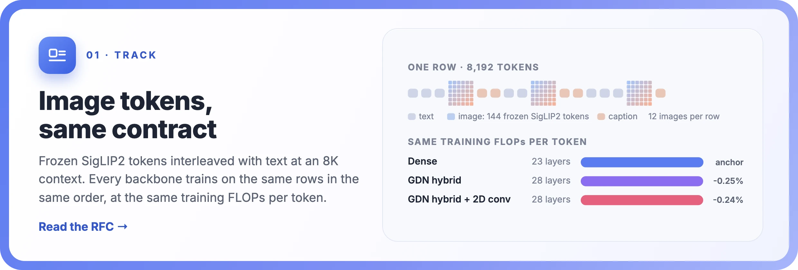
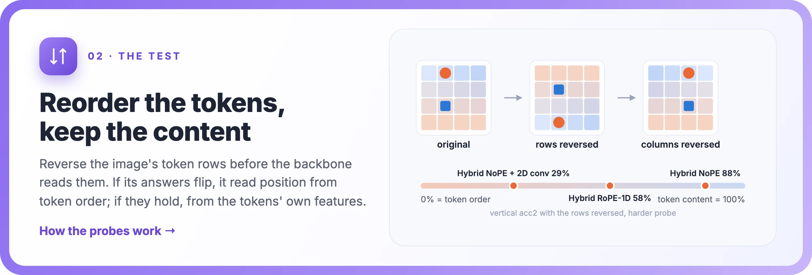
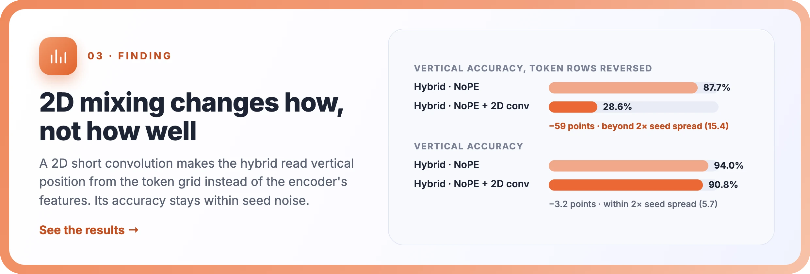
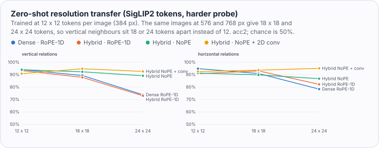
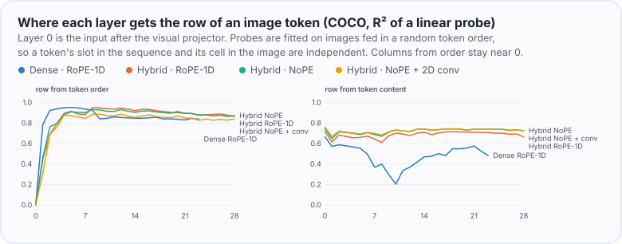
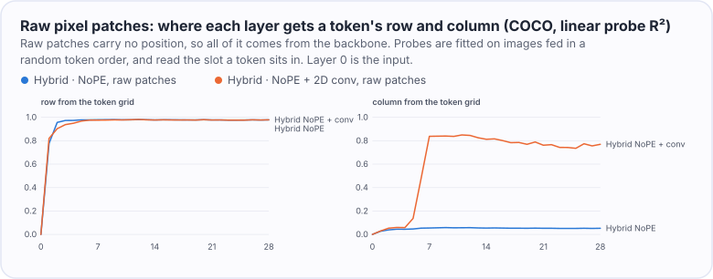

<div align="center">


<h3>A compute-matched testbed for vision-language backbones,<br>built on the NextTransformer protocol</h3>

<p>
<a href="#results"></a>
<a href="docs/rfc-multimodal-track.md"></a>
<a href="#reproduce"></a>
</p>

<p>
<a href="https://github.com/Interactive-Active-AI/NextTransformer"></a>
<a href="docs/spatial-preregistration.md"></a>
<a href="results/compute-audit.txt"></a>
<a href="LICENSE"></a>


</p>

<b>English</b> · <a href="README.zh-CN.md">简体中文</a>

</div>

<br>

**When part of every sequence is an image, how should a backbone spend a fixed training budget?** NextTransformer-V
keeps [NextTransformer](https://github.com/Interactive-Active-AI/NextTransformer)'s contract:
- the same data in the same order;
- training FLOPs per token matched to within 1% by the same operator ledger;
- the same evaluation points.

It interleaves frozen vision-encoder tokens with text at an 8,192-token context, and every NextTransformer method runs
on them unchanged. The first study asks where a hybrid backbone gets the 2D layout of an image, and whether making its
linear mixing 2D-aware helps. The study was pre-registered.

## News

-  **2026-11-04** ·
  Resolution transfer and a layer-by-layer probe.
  - At a resolution not seen in training, models that read position through RoPE-1D lose 13–20 points, and the 2D
    convolution keeps accuracy.
  - With raw pixels, where the encoder supplies no position, the convolution is what lets the hybrid tell left from
    right (51% → 99%).
-  **2026-11-04** · First
  study: the 2D position of image tokens in hybrid backbones. It has eleven compute-matched runs, two seed pairs, a
  raw-pixel replication and a pre-registered decision.
-  **2026-11-04** · The
  pilot is complete. The further raw-pixel runs and the backbone benchmark listed in `configs/pilot/jobs.txt` were not
  run.

## Highlights







## Results

Every number comes from the files in [`results/`](results/). The tables in
[`results/tables.md`](results/tables.md) and the figures in this README are generated from those files by
`python -m ntv.analysis`.

**Setup.** Every run has the same budget: 5,000 updates of 128 rows x 8,192 tokens (5.24B tokens), 12 images per row,
and training FLOPs per token within 1% of the Dense anchor. Models have 1.4–1.6B parameters. The runs differ in three
things:

| | |
|---|---|
| **Backbone** | Dense, or the GDN hybrid, where three of every four layers are Gated DeltaNet |
| **Attention position encoding** | RoPE-1D over the flattened sequence, NoPE, or RoPE-2D |
| **2D short convolution** | with or without a 3 x 3 depthwise convolution over each image's token grid, replacing the 1D short convolution of the linear layers at image positions |

Image tokens are frozen SigLIP2 features (so400m/16 at 384 px, merged 2 x 2 into 12 x 12 tokens) fed in raster order.
Two configurations were repeated with a second seed to measure noise.

### 1 · The pre-registered rule: not effective with SigLIP2 tokens, inconclusive with raw pixels

| 2D convolution against | vertical acc2 gain | caption BPB change | text BPB change | verdict |
|---|---:|---:|---:|---|
| the NoPE hybrid | +0.1 points | +0.0025 | +0.0001 | not effective |
| the RoPE-1D hybrid | +0.1 points | +0.0022 | -0.0002 | not effective |
| the NoPE hybrid, raw pixel patches | +2.1 points | -0.0019 | -0.0002 | inconclusive (section 6) |

The rule needed a gain of at least 5 points, above twice the seed spread, which is 0.1 points. With SigLIP2 tokens it
could not be met, because the primary metric is saturated: every SigLIP2 run reaches 99.9–100% vertical acc2 on the
synthetic probe. There are two reasons. The training mix contains images with the probe's layout, and SigLIP2 tokens carry their own position:
ridge regression recovers a token's row and column with R² 0.86 / 0.89, against 0.03 / 0.00 for raw pixel patches.

### 2 · The backbones read position from different sources

The runs are scored again on a harder probe (finer grid, smaller objects, more distractors) with the image tokens
reordered, their content unchanged. Reversing the columns of each token row inverts the horizontal answers of a backbone
that reads horizontal position from token order. Reversing the token rows does the same for vertical position.


| run | horizontal, columns reversed | vertical, rows reversed |
|---|---:|---:|
| Dense, RoPE-1D | 80.5% | 31.9% |
| Dense, NoPE | 82.0% | 51.7% |
| Hybrid, RoPE-1D (seeds 42 / 43) | 27.7% / 30.8% | 58.3% / 65.5% |
| Hybrid, RoPE-2D | 36.9% | 61.2% |
| Hybrid, NoPE | 19.0% | 87.7% |
| Hybrid, NoPE + 2D conv (seeds 42 / 43) | 19.5% / 22.1% | 28.6% / 20.9% |
| Hybrid, RoPE-1D + 2D conv | 20.0% | 21.0% |

Measured with the two seed pairs, the seed spread is 3.1 points for the first column and 7.7 for the second. The
differences below are all larger than twice that:

- The GDN recurrence reads horizontal position from token order. The hybrids stay at 19–37% when the columns are
  reversed; Dense stays at 80–82%.
- The NoPE hybrid reads vertical position from the encoder's features, at 87.7% with the rows reversed.
- The 2D convolution moves vertical position to the token grid in both position modes. With the rows reversed,
  vertical accuracy falls 37 points with RoPE-1D and 59 points with NoPE.

RoPE-2D, by contrast, does not change where the hybrid reads vertical position from. With the rows reversed it
scores 61.2%, against 58.3% for RoPE-1D, a gap within the seed spread.

With the 2D convolution, vertical position is read from the token grid from the first checkpoint on. Without it, the
NoPE hybrid relies more and more on the encoder's features as training goes on.


### 3 · Accuracy and loss do not change beyond seed noise

- On the harder probe, every run scores 88–96% on both axes. No contrast exceeds twice the seed spread, which is 2.9
  points vertically and 2.6 points horizontally.
- COCO caption BPB is 0.84–0.86 and COCO 5-way retrieval 98% for every run.
- What'sUp stays at about 50%, near chance, at this scale.


### 4 · At a new resolution, 1D RoPE breaks and 2D-aware mixing holds

The final checkpoints were scored, without retraining, on the same harder-probe images at 576 px and 768 px. That gives
18 x 18 and 24 x 24 tokens per image instead of the 12 x 12 seen in training, so vertical neighbours sit 18 or 24
tokens apart instead of 12. SigLIP2 interpolates its position embedding. At 384 px the evaluation code reproduces the
archived results exactly.



| run | vertical acc2 at 384 → 768 px | change | horizontal change |
|---|---:|---:|---:|
| Dense, RoPE-1D | 94.1% → 73.8% | -20.3 | -16.5 |
| Hybrid, RoPE-1D (seeds 42 / 43) | 93.3% → 73.0% / 96.1% → 82.9% | -20.3 / -13.3 | -8.6 / -17.5 |
| Hybrid, RoPE-1D + 2D conv | 93.0% → 84.6% | -8.4 | -1.1 |
| Hybrid, RoPE-2D | 91.4% → 86.3% | -5.1 | -11.4 |
| Hybrid, NoPE | 94.0% → 89.1% | -4.8 | -4.6 |
| Hybrid, NoPE + 2D conv (seeds 42 / 43) | 90.8% → 92.6% / 91.4% → 90.3% | +1.8 / -1.1 | +2.5 / -0.3 |
| Dense, NoPE | 94.1% → 95.4% | +1.3 | +0.2 |

- **RoPE-1D causes the loss, whatever the backbone.** Models with RoPE-1D lose 13–20 points vertically at 768 px, Dense
  and hybrid alike. NoPE models lose at most 5 points.
- **The 2D convolution removes the loss.** With it, the NoPE hybrid keeps its accuracy on both axes in both seeds. With
  RoPE-1D, the convolution cuts the vertical loss to 8 points.
- **How sure this is.** Measured with the two seed pairs, the seed spread of the vertical change is 7.0 points.
  - Dense RoPE-1D against Dense NoPE (21.6 points apart) is beyond twice that spread.
  - The hybrid with RoPE-1D against the NoPE hybrid with the 2D convolution is 12–22 points apart across the four
    seed pairings. Three of the four pairings exceed twice the spread (14 points); the smallest gap is 12 points.

### 5 · What the layers know

A linear probe reads each image token's row and column from the residual stream, layer by layer, on COCO images. To
tell position from token order apart from position carried in the token's content, the probe is fitted on images whose
tokens are fed in a random order, where the two are independent.



- **Every backbone works out a token's row from token order** within its first few layers (R² 0.83–0.98), but
  almost none of its column (R² 0.15 at most, highest with RoPE-2D). The row is close to a linear function of a token's
  index in the image (index / 12); the column (index mod 12) is not.
- **The hybrids keep the encoder's position** (content row R² about 0.7 in every layer). Dense with RoPE-1D loses much of
  it in its middle layers (0.37), which fits its reading of vertical relations from token order.
- **GDN layers forget more slowly over image tokens than over text.** After one image row (12 tokens), the median head
  keeps 62–83% of its state at image positions and 33–61% at caption positions, in every hybrid run. Decay alone
  therefore does not stop the recurrence from spanning a row.

### 6 · Without position from the encoder, the 2D convolution is what gives the hybrid its columns

Raw 32 px patches (3,072 pixel values per token, no encoder) carry no position, so everything must come from the
backbone. This is the pre-registered replication pair: the NoPE hybrid with and without the 2D convolution.

| raw patches, hybrid with NoPE | without 2D conv | with 2D conv |
|---|---:|---:|
| vertical acc2, synthetic probe (primary metric) | 97.6% | 99.6% |
| horizontal acc2, synthetic probe | 50.8% (chance) | **99.0%** |
| vertical / horizontal acc2, harder probe | 79.5% / 52.0% | 79.4% / **74.4%** |
| caption BPB / text BPB | 0.9241 / 0.7200 | 0.9222 / 0.7198 |
| COCO caption BPB / 5-way retrieval | 1.0230 / 76.3% | 1.0176 / 78.2% |

- **Pre-registered verdict: inconclusive.** On the primary metric the convolution gains 2.1 points. That is beyond twice
  the seed spread (0.1 points) but short of the 5-point bar. Neither caption nor text BPB gets worse.
- **Without the convolution, the hybrid cannot tell left from right.** It reads vertical relations from token order:
  reversing the rows inverts them (2.6%). Its horizontal accuracy stays at chance.
- **With the convolution, it learns both.** On the synthetic probe, horizontal accuracy goes from chance to 99.0%. On
  the harder probe it rises by 22.4 points, beyond twice that probe's seed spread (5.3). Reversing either the rows or
  the columns now inverts the answers (4.2% each), so both axes are read from the token grid.

The layer probe shows where the columns come from:



- **Rows.** Both models work out a token's row from token order within two layers.
- **Columns without the convolution.** The model never recovers them (R² 0.05).
- **Columns with the convolution.** They appear by block 7 (R² 0.84). A 3 x 3 convolution with zero padding sees the
  image border, and stacking it across GDN layers lets the model count from the edge. Convolutional networks are known
  to encode absolute position the same way. Seven GDN layers with the convolution precede that block, enough to reach
  the middle of a 12-column grid.

At 768 px both raw-patch models lose accuracy (vertical -23.8 and -15.3 points). Here the input itself changes too,
because each 32 px patch then covers a smaller, blurrier part of the image. These numbers are in
[`results/tables.md`](results/tables.md) but are not interpreted.

> **In short:**
> - **Where position comes from.** With a position-aware encoder, the 2D position of image tokens comes mostly from
>   the encoder. The backbone adds a token's row from token order, but not its column.
> - **What a 2D-aware linear mixer changes.** It changes *how* position is read, not *how well*, at the training
>   resolution.
> - **Where that difference matters.** At a new resolution, reading position through RoPE-1D breaks, while the 2D
>   convolution keeps accuracy. When the encoder supplies no position at all, the convolution is what lets a hybrid
>   locate a token's column.

## Design of the track

| | |
|---|---|
| **Visual tokens** | Frozen SigLIP2, 144 tokens per image, with a projector of two linear layers. Forward hooks on the token and value embeddings feed the images, so every NextTransformer method runs unchanged. With no images, the model is bitwise identical to NextTransformer's. A raw-patch input (32 px patches, no encoder) is also available. |
| **Data** | CC12M and CC3M image-caption pairs, plus synthetic spatial-relation images, packed with ClimbMix text into 8,193-position rows. Each row holds 12 documents of the form `[BOS] [image] caption`, and the packing is deterministic. The text evaluation uses the dev shard (06541). The validation shard (06542) and CORE are not used. |
| **Compute** | NextTransformer's operator ledger audits the multimodal model. Every backbone is calibrated to within 1% of the Dense anchor at 8,192 tokens (5.9956 GFLOPs per token) with the v2 grid rule ([`configs/track`](configs/track)). [`scripts/audit_variants.py`](scripts/audit_variants.py) checks every pilot variant; the largest deviation is 0.29% ([`results/compute-audit.txt`](results/compute-audit.txt)). |
| **Evaluation** | Caption and text BPB; COCO 5k caption BPB and retrieval by likelihood; the synthetic probe, its harder version and the token-order scrambles; What'sUp. |

The [RFC](docs/rfc-multimodal-track.md) lists what the prototype had to work around in NextTransformer, which could
become upstream hooks. A tested patch for the cost ledger is in [`upstream/`](upstream/).

## Reproduce

Python 3.10 (`.python-version`) with [uv](https://docs.astral.sh/uv/). NextTransformer is a submodule pinned at the
commit this was built on, and none of its files are changed. Everything below writes under `$NTV_ROOT`.

```bash
git clone --recursive https://github.com/Enderfga/NextTransformer-V.git && cd NextTransformer-V
export NTV_ROOT=<a large local disk>
bash scripts/bootstrap.sh                                   # environment (.venv), torch 2.9.1 + fla
```

<details>
<summary><b>Data:</b> pinned downloads, synthetic probes, packing</summary>

```bash
# Inputs, at pinned revisions
bash scripts/download.sh climbmix 128 && bash scripts/download.sh siglip2
bash scripts/download.sh cc12m 0 995 && bash scripts/download.sh cc3m 0 575
bash scripts/download.sh coco5k && bash scripts/download.sh whatsup
python -m ntv.prepare_text --data-dir $NTV_ROOT/data/climbmix --resources $NTV_ROOT/resources   # pinned tokenizer
python -m ntv.whatsup --root $NTV_ROOT/data/whatsup

# Synthetic spatial-relation images: training shards, the probe, and the harder probe
python -m ntv.synth train --out $NTV_ROOT/data/synth --shards 120 --per-shard 5000 --seed 1
python -m ntv.synth eval --out $NTV_ROOT/data/synth-eval --count 2000 --seed 2
python -m ntv.synth eval --out $NTV_ROOT/data/synth-hard --count 2000 --seed 3 --grid 8 --radius 12,18 \
    --distractors 3,7 --jitter 6

# Packed rows (640,000 training rows; 256 validation rows on the dev shard)
python -m ntv.pack --tar-root $NTV_ROOT/data --source cc12m/cc12m-train:0:991 --source cc3m/cc3m-train:0:575 \
    --source synth/synth-train:0:119 --text $NTV_ROOT/data/climbmix --text-shards 0 79 \
    --resources $NTV_ROOT/resources --rows 640000 --out $NTV_ROOT/packed/pilot-train
python -m ntv.pack --tar-root $NTV_ROOT/data --source cc12m/cc12m-train:992:995 --text $NTV_ROOT/data/climbmix \
    --text-shards 6541 --resources $NTV_ROOT/resources --rows 256 --out $NTV_ROOT/packed/pilot-val
```

</details>

<details>
<summary><b>Runs and report:</b> train, evaluate, apply the pre-registered decision</summary>

```bash
# Train and evaluate the pilot runs on an 8-GPU node (about 4.5 hours per run on H200)
bash scripts/pilot.sh configs/pilot/jobs.txt

# Report, pre-registered decision, tables and figures
python scripts/export_results.py $NTV_ROOT/runs results    # summaries without site paths
python -m ntv.analysis results --out report.html --json results/decision.json --markdown results/tables.md \
    --figures docs/figures
```

Calibration is already in [`configs/track`](configs/track). To redo it, run
`python -m ntv.calibrate --methods dense_full gdn gdn_hybrid nsa qsa qsa_hybrid mhc --out configs/track`. The linear
position probe of the visual tokens is `python -m ntv.position_probe`.

</details>

## Repository layout

| Path | Contents |
|---|---|
| `ntv/model.py`, `ntv/spatial.py` | visual inputs for any NextTransformer method; patch order, RoPE-2D, 2D short convolution |
| `ntv/encoder.py`, `ntv/data.py`, `ntv/pack.py` | frozen encoder, packed rows, deterministic packing |
| `ntv/cost.py`, `ntv/calibrate.py` | compute audit and calibration with NextTransformer's ledger |
| `ntv/train.py` | trainer (NextTransformer's optimizer, schedule and checkpoint format) |
| `ntv/evaluate.py`, `ntv/spatial_eval.py`, `ntv/synth.py`, `ntv/whatsup.py`, `ntv/position_probe.py` | evaluations |
| `ntv/analysis.py` | pre-registered decision, report, tables and figures |
| `configs/` | calibrated backbones, the pilot job list |
| `docs/` | pre-registration, addendum, RFC; README figures and assets |
| `results/` | summaries of every finished run (metrics and evaluation files), the compute audit |
| `upstream/` | proposed patches for NextTransformer |

## License

MIT, like NextTransformer ([LICENSE](LICENSE)). The banner background is a generated watercolor illustration; all
figures and cards are drawn from the result files ([`docs/assets/src`](docs/assets/src)).
