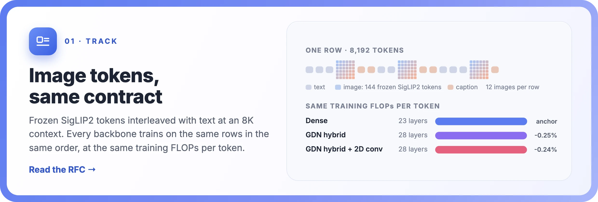
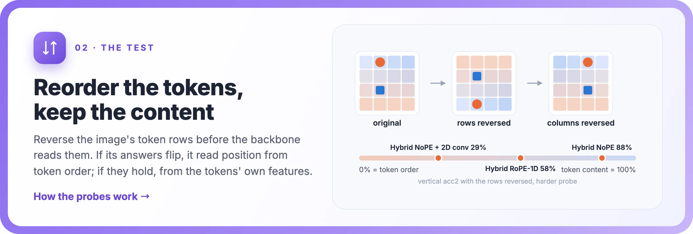
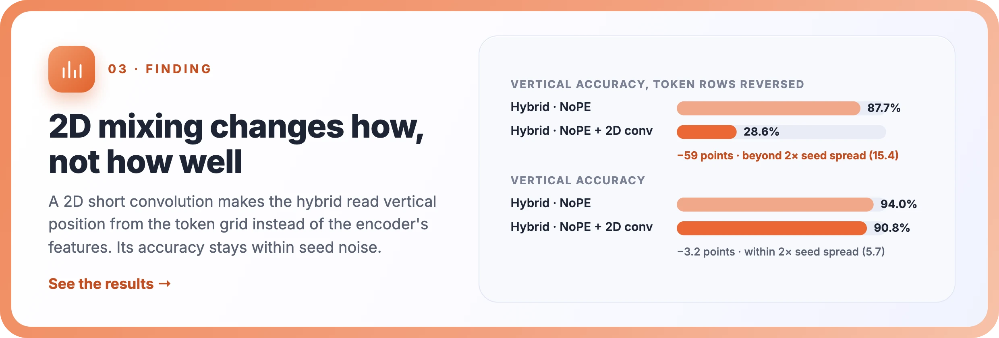
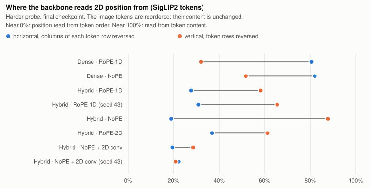
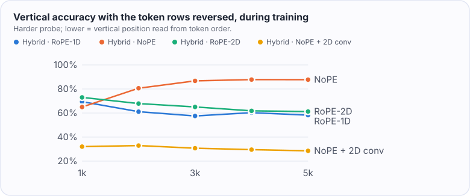
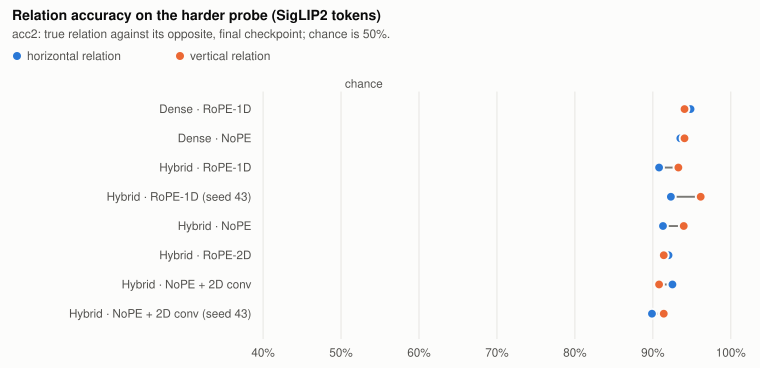
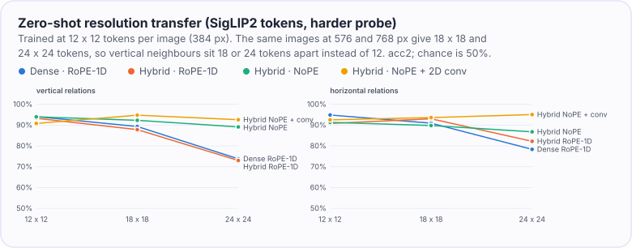
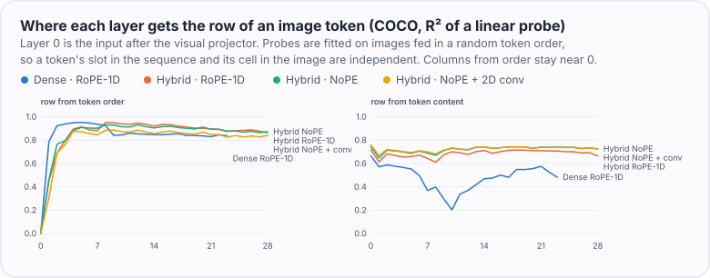
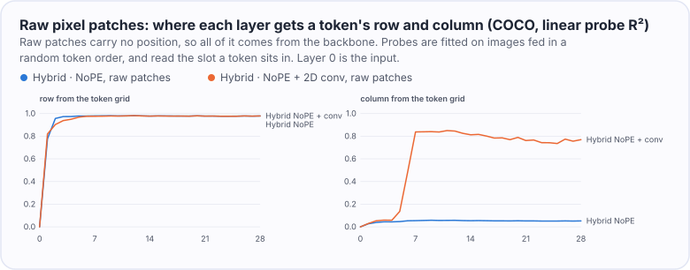

<div align="center">


<h3>算力对齐的视觉-语言骨干网络试验台，<br>建立在 NextTransformer 协议之上</h3>

<p>
<a href="#结果"></a>
<a href="docs/rfc-multimodal-track.md"></a>
<a href="#复现"></a>
</p>

<p>
<a href="https://github.com/Interactive-Active-AI/NextTransformer"></a>
<a href="docs/spatial-preregistration.md"></a>
<a href="results/compute-audit.txt"></a>
<a href="LICENSE"></a>


</p>

<a href="README.md">English</a> · <b>简体中文</b>

</div>

<br>

**当每条序列里都有一部分是图像时，骨干网络该怎样花一份固定的训练预算？** NextTransformer-V 沿用
[NextTransformer](https://github.com/Interactive-Active-AI/NextTransformer) 的约定：
- 同样的数据，同样的顺序；
- 用同一套算子账本，把每个 token 的训练 FLOPs 对齐到 1% 以内；
- 同样的评估时间点。

它把冻结视觉编码器输出的 token 和文本交错排进 8,192 长度的上下文，NextTransformer 的每种方法都不用改动就能直接训练。
第一项研究问的是：混合骨干从哪里得到图像的二维布局，以及让它的线性混合层感知二维结构有没有用。这项研究的判定规则在开跑前就已写定。

## 动态

-  **2026-11-04** · 换分辨率与逐层探测：
  - 换到训练时没见过的分辨率，依赖 RoPE-1D 读位置的模型掉 13–20 个百分点，二维卷积保持住准确率；
  - 原始像素输入下（编码器不提供位置），正是二维卷积让混合骨干分得清左右（51% → 99%）。
-  **2026-11-04** · 第一项研究：混合骨干里图像 token 的二维位置。包含 11 个算力对齐的 run、两对换种子的 run、一组原始像素复现，以及预注册的判定。
-  **2026-11-04** · 更多原始像素 run（RoPE-1D、RoPE-2D、Dense）。
-  **2026-11-05** · 8,192 上下文下的骨干对比（GDN、QSA 混合、mHC）。

## 亮点







## 结果

所有数字都来自 [`results/`](results/) 里的文件。[`results/tables.md`](results/tables.md) 里的表格和本页的图，都由 `python -m ntv.analysis` 从这些文件生成。

**设置。** 每个 run 的预算相同：
- 5,000 步，每步 128 行 × 8,192 token（共 52.4 亿 token）；
- 每行 12 张图；
- 每 token 的训练 FLOPs 与 Dense 锚点相差不到 1%。

模型参数量为 14–16 亿。各 run 只在三个方面不同：

| | |
|---|---|
| **骨干** | Dense，或 GDN 混合骨干（每 4 层中有 3 层是 Gated DeltaNet） |
| **注意力位置编码** | 展平序列上的 RoPE-1D、不加位置编码（NoPE），或 RoPE-2D |
| **二维短卷积** | 加或不加：在图像位置上，用每张图 token 网格上的 3×3 depthwise 卷积替换线性层原有的一维短卷积 |

图像 token 是冻结的 SigLIP2 特征（so400m/16，384 像素，2×2 合并成 12×12 个 token），按行优先顺序输入。有两个配置用第二个种子各重跑了一次，用来估计噪声。

### 1 · 预注册判定：SigLIP2 下无效，原始像素下不确定

| 二维卷积对比的基线 | 垂直 acc2 提升 | caption BPB 变化 | 文本 BPB 变化 | 判定 |
|---|---:|---:|---:|---|
| NoPE 混合骨干 | +0.1 个百分点 | +0.0025 | +0.0001 | 无效 |
| RoPE-1D 混合骨干 | +0.1 个百分点 | +0.0022 | -0.0002 | 无效 |
| NoPE 混合骨干，原始像素输入 | +2.1 个百分点 | -0.0019 | -0.0002 | 不确定（见第 6 节） |

规则要求提升至少 5 个百分点，并且超过种子间波动（0.1 个百分点）的 2 倍。在 SigLIP2 下这一条达不到，因为主指标已经饱和：每个 SigLIP2 run 在合成探针上的垂直 acc2 都在 99.9–100%。原因有两个：
- 训练数据里本来就有和探针布局相同的合成图。
- SigLIP2 token 本身带着位置信息：用岭回归从 token 特征读它的行和列，R² 分别有 0.86 / 0.89；原始像素 patch 只有 0.03 / 0.00。

### 2 · 不同骨干从不同来源读位置

在更难的探针上（网格更细、物体更小、干扰物更多）重新打分，并把图像 token 送进骨干的顺序打乱，内容保持不变：
- 如果骨干是从 token 顺序读水平位置，把每一行的 token 倒过来，它对左右关系的判断就会反转。
- 把 token 的行倒过来，同理可以检验垂直位置。



| run | 每行内倒序后的水平准确率 | 行倒序后的垂直准确率 |
|---|---:|---:|
| Dense，RoPE-1D | 80.5% | 31.9% |
| Dense，NoPE | 82.0% | 51.7% |
| 混合，RoPE-1D（种子 42 / 43） | 27.7% / 30.8% | 58.3% / 65.5% |
| 混合，RoPE-2D | 36.9% | 61.2% |
| 混合，NoPE | 19.0% | 87.7% |
| 混合，NoPE + 二维卷积（种子 42 / 43） | 19.5% / 22.1% | 28.6% / 20.9% |
| 混合，RoPE-1D + 二维卷积 | 20.0% | 21.0% |

用两对换种子的 run 测出的波动是：第一列 3.1 个百分点，第二列 7.7 个百分点。下面这些差别都超过了波动的 2 倍：
- **GDN 的循环结构从 token 顺序读水平位置。** 每行倒序后，混合骨干只剩 19–37%，Dense 仍有 80–82%。
- **不加位置编码的混合骨干从编码器特征读垂直位置。** 行倒序后仍有 87.7%。
- **二维卷积在两种位置编码下，都让垂直位置改从 token 网格读。** 行倒序后，垂直准确率在 RoPE-1D 下降 37 个百分点，在 NoPE 下降 59 个百分点。

相比之下，RoPE-2D 没有改变混合骨干读垂直位置的方式：行倒序后它是 61.2%，RoPE-1D 是 58.3%，差别在波动以内。

加了二维卷积的模型，从第一个 checkpoint 起就从 token 网格读垂直位置；不加的 NoPE 混合骨干，则随着训练越来越依赖编码器特征。



### 3 · 准确率和 loss 没有超出种子波动的变化

- **难版探针：** 每个 run 在两个方向上的准确率都是 88–96%。没有任何一组对比超过波动的 2 倍（垂直 2.9、水平 2.6 个百分点）。
- **COCO：** 每个 run 的 caption BPB 都在 0.84–0.86，5 选 1 检索都在 98%。
- **What'sUp：** 在这个规模下约 50%，接近随机。



### 4 · 换一个分辨率：RoPE-1D 失效，二维感知的混合层保持住

不重新训练，把同样的难版探针图片放大到 576 和 768 像素，用最终 checkpoint 打分。这样每张图变成 18×18 和 24×24 个 token，而训练时是 12×12，上下相邻的 token 在序列里相隔 18 或 24 个位置，不再是 12 个。SigLIP2 会对它的位置编码做插值。在 384 像素下，评估代码和存档结果逐位一致。



| run | 垂直 acc2：384 → 768 像素 | 变化 | 水平变化 |
|---|---:|---:|---:|
| Dense，RoPE-1D | 94.1% → 73.8% | -20.3 | -16.5 |
| 混合，RoPE-1D（种子 42 / 43） | 93.3% → 73.0% / 96.1% → 82.9% | -20.3 / -13.3 | -8.6 / -17.5 |
| 混合，RoPE-1D + 二维卷积 | 93.0% → 84.6% | -8.4 | -1.1 |
| 混合，RoPE-2D | 91.4% → 86.3% | -5.1 | -11.4 |
| 混合，NoPE | 94.0% → 89.1% | -4.8 | -4.6 |
| 混合，NoPE + 二维卷积（种子 42 / 43） | 90.8% → 92.6% / 91.4% → 90.3% | +1.8 / -1.1 | +2.5 / -0.3 |
| Dense，NoPE | 94.1% → 95.4% | +1.3 | +0.2 |

- **掉分来自 RoPE-1D，与骨干无关。** 用 RoPE-1D 的模型在 768 像素下垂直方向掉 13–20 个百分点，Dense 和混合骨干都一样；不加位置编码的模型最多掉 5 个百分点。
- **二维卷积消除了这部分损失。** 不加位置编码的混合骨干加上卷积后，两个种子在两个方向上都保持住了准确率；RoPE-1D 加上卷积，垂直方向的损失降到 8 个百分点。
- **把握有多大。** 用两对种子量出的"垂直变化"的种子波动是 7.0 个百分点：
  - Dense 的 RoPE-1D 和 NoPE 相差 21.6 个百分点，超过波动的 2 倍；
  - 混合 RoPE-1D 和"NoPE + 二维卷积"之间，四种种子搭配相差 12–22 个百分点，其中三种超过波动的 2 倍（14 个百分点），最小差距为 12 个百分点。

### 5 · 每一层知道什么

用线性探针在 COCO 图片上，逐层从残差流里读出每个图像 token 的行和列。为了区分"从 token 顺序得到的位置"和"token 内容里带的位置"，探针是在 token 顺序被随机打乱的图片上拟合的，这时两者互相独立。



- **每种骨干都在前几层就从 token 顺序算出"第几行"**（R² 0.83–0.98），但几乎算不出"第几列"（R² 最高 0.15，出现在 RoPE-2D）。行号接近 token 在图里的序号的线性函数（序号 ÷ 12），列号（序号除以 12 的余数）不是。
- **混合骨干保留了编码器的位置信息**（各层的内容行 R² 都在 0.7 左右）。Dense · RoPE-1D 在中间层丢掉了大半（0.37），这和它从顺序读上下关系一致。
- **GDN 层在图像 token 上比在文字上忘得慢。** 走过一行图像（12 个 token）后，每个混合 run 里中位数的头在图像位置保留 62–83% 的状态，在字幕位置保留 33–61%。所以单靠衰减并不会让循环结构跨不过一行。

### 6 · 编码器不提供位置时，二维卷积让混合骨干认出"第几列"

原始像素 patch（每个 token 是 32 像素见方的 3,072 个像素值，不用编码器）本身不带位置信息，所有位置都得由骨干自己提供。这是预注册的复现对比：不加位置编码的混合骨干，加与不加二维卷积。

| 原始像素，混合骨干 NoPE | 不加二维卷积 | 加二维卷积 |
|---|---:|---:|
| 垂直 acc2，合成探针（主指标） | 97.6% | 99.6% |
| 水平 acc2，合成探针 | 50.8%（随机水平） | **99.0%** |
| 垂直 / 水平 acc2，难版探针 | 79.5% / 52.0% | 79.4% / **74.4%** |
| caption BPB / 文本 BPB | 0.9241 / 0.7200 | 0.9222 / 0.7198 |
| COCO caption BPB / 5 选 1 检索 | 1.0230 / 76.3% | 1.0176 / 78.2% |

- **预注册判定：不确定。** 主指标提升 2.1 个百分点，超过种子波动的 2 倍（0.1 个百分点），但不到 5 个百分点的门槛；caption 和文本 BPB 都没有变差。
- **不加卷积时，混合骨干分不清左右。** 它从 token 顺序读上下关系，把行倒过来答案就反转（2.6%）；左右判断停在随机水平。
- **加了卷积，两个方向都学会了。** 合成探针上的左右判断从随机水平提到 99.0%；难版探针上提高 22.4 个百分点，超过该探针种子波动的 2 倍（5.3）。现在无论倒转行还是列，答案都会反过来（各 4.2%），说明两个方向都从 token 网格读。

逐层探测显示了"列"从哪里来：



- **行：** 两个模型都在前两层从顺序算出了"第几行"。
- **不加卷积时的列：** 始终算不出来（R² 0.05）。
- **加卷积后的列：** 到第 7 个块出现（R² 0.84）。3×3 卷积在边缘补零，所以能看见图像边界；在多个 GDN 层里叠加后，模型就能从边缘往里数。卷积网络用同样的方式编码绝对位置，这已有研究报告过。在这个块之前有 7 个带卷积的 GDN 层，足够数到 12 列网格的中间。

放大到 768 像素后，两个原始像素模型都会掉分（垂直 -23.8 和 -15.3 个百分点）。但这时输入本身也变了：每个 32 像素的块覆盖的画面更小、更模糊。这些数字放在 [`results/tables.md`](results/tables.md) 里，不做解读。

> **一句话：**
> - **位置从哪来：** 编码器本身带位置信息时，图像 token 的二维位置主要来自编码器。骨干会从 token 顺序补上"第几行"，但补不出"第几列"。
> - **二维感知的线性混合改变了什么：** 在训练分辨率下，它改变的是模型*怎么*读位置，而不是读得*准不准*。
> - **这个差别在哪里起作用：** 换一个分辨率，依赖 RoPE-1D 读位置的方式就会失效，二维卷积能保住准确率。编码器完全不提供位置时，正是这个卷积让混合骨干认出了 token 在第几列。

## 赛道设计

| | |
|---|---|
| **视觉 token** | 冻结的 SigLIP2，每张图 144 个 token，经过两层线性投影。<br>图像通过 token embedding 和 value embedding 上的前向 hook 输入，因此 NextTransformer 的每种方法都不需要改动；没有图像时，模型与 NextTransformer 逐位一致。<br>另有原始像素输入（32 像素 patch，不用编码器）。 |
| **数据** | CC12M、CC3M 图文对，加上合成空间关系图，和 ClimbMix 文本一起打包成 8,193 长度的行。<br>每行 12 个 `[BOS] [image] caption` 文档，打包过程完全确定。<br>文本评估用 dev shard（06541），没有使用验证 shard（06542）和 CORE。 |
| **算力** | 多模态模型的算力用 NextTransformer 的算子账本核算。<br>每个骨干都用 v2 网格规则校准到 8,192 上下文下 Dense 锚点（每 token 5.9956 GFLOPs）的 1% 以内（[`configs/track`](configs/track)）。<br>[`scripts/audit_variants.py`](scripts/audit_variants.py) 逐一核对了每个实验变体，最大偏差 0.29%（[`results/compute-audit.txt`](results/compute-audit.txt)）。 |
| **评估** | caption 与文本 BPB；COCO 5k caption BPB 和基于似然的检索；合成探针、难版探针与打乱 token 顺序的测试；What'sUp。 |

[RFC](docs/rfc-multimodal-track.md) 列出了原型在 NextTransformer 上需要绕开的地方，这些都可以做成上游接口。给算力账本的补丁已经写好并测试过，放在 [`upstream/`](upstream/)。

## 复现

Python 3.10（见 `.python-version`），使用 [uv](https://docs.astral.sh/uv/)。NextTransformer 以子模块形式锁定在本项目所基于的那个 commit，它的文件没有任何改动。下面所有输出都写在 `$NTV_ROOT` 下。

```bash
git clone --recursive https://github.com/Enderfga/NextTransformer-V.git && cd NextTransformer-V
export NTV_ROOT=<一块足够大的本地盘>
bash scripts/bootstrap.sh                                   # 环境（.venv），torch 2.9.1 + fla
```

<details>
<summary><b>数据：</b>锁定版本的下载、合成探针、打包</summary>

```bash
# 锁定版本的输入数据
bash scripts/download.sh climbmix 128 && bash scripts/download.sh siglip2
bash scripts/download.sh cc12m 0 995 && bash scripts/download.sh cc3m 0 575
bash scripts/download.sh coco5k && bash scripts/download.sh whatsup
python -m ntv.prepare_text --data-dir $NTV_ROOT/data/climbmix --resources $NTV_ROOT/resources   # 锁定的 tokenizer
python -m ntv.whatsup --root $NTV_ROOT/data/whatsup

# 合成空间关系图：训练分片、探针、难版探针
python -m ntv.synth train --out $NTV_ROOT/data/synth --shards 120 --per-shard 5000 --seed 1
python -m ntv.synth eval --out $NTV_ROOT/data/synth-eval --count 2000 --seed 2
python -m ntv.synth eval --out $NTV_ROOT/data/synth-hard --count 2000 --seed 3 --grid 8 --radius 12,18 \
    --distractors 3,7 --jitter 6

# 打包（训练 640,000 行；验证 256 行，取自 dev shard）
python -m ntv.pack --tar-root $NTV_ROOT/data --source cc12m/cc12m-train:0:991 --source cc3m/cc3m-train:0:575 \
    --source synth/synth-train:0:119 --text $NTV_ROOT/data/climbmix --text-shards 0 79 \
    --resources $NTV_ROOT/resources --rows 640000 --out $NTV_ROOT/packed/pilot-train
python -m ntv.pack --tar-root $NTV_ROOT/data --source cc12m/cc12m-train:992:995 --text $NTV_ROOT/data/climbmix \
    --text-shards 6541 --resources $NTV_ROOT/resources --rows 256 --out $NTV_ROOT/packed/pilot-val
```

</details>

<details>
<summary><b>训练与报告：</b>训练、评估、应用预注册判定</summary>

```bash
# 在一台 8 卡机器上依次训练并评估所有 run（H200 上每个约 4.5 小时）
bash scripts/pilot.sh configs/pilot/jobs.txt

# 报告、预注册判定、表格和图
python scripts/export_results.py $NTV_ROOT/runs results    # 去掉站点路径的结果摘要
python -m ntv.analysis results --out report.html --json results/decision.json --markdown results/tables.md \
    --figures docs/figures
```

校准结果已在 [`configs/track`](configs/track) 里。要重新校准，运行
`python -m ntv.calibrate --methods dense_full gdn gdn_hybrid nsa qsa qsa_hybrid mhc --out configs/track`。
视觉 token 的线性位置探针是 `python -m ntv.position_probe`。

</details>

## 仓库结构

| 路径 | 内容 |
|---|---|
| `ntv/model.py`、`ntv/spatial.py` | 给任意 NextTransformer 方法接入视觉输入；patch 顺序、RoPE-2D、二维短卷积 |
| `ntv/encoder.py`、`ntv/data.py`、`ntv/pack.py` | 冻结编码器、打包好的行、确定性打包 |
| `ntv/cost.py`、`ntv/calibrate.py` | 用 NextTransformer 的账本做算力核算与校准 |
| `ntv/train.py` | 训练器（沿用 NextTransformer 的优化器、学习率计划和 checkpoint 格式） |
| `ntv/evaluate.py`、`ntv/spatial_eval.py`、`ntv/synth.py`、`ntv/whatsup.py`、`ntv/position_probe.py` | 各项评估 |
| `ntv/analysis.py` | 预注册判定、报告、表格和图 |
| `configs/` | 校准好的骨干配置、实验清单 |
| `docs/` | 预注册、附录、RFC；README 的图和素材 |
| `results/` | 每个已完成 run 的结果摘要（指标和评估文件）、算力核算 |
| `upstream/` | 给 NextTransformer 的补丁 |

## 许可证

MIT，与 NextTransformer 相同（[LICENSE](LICENSE)）。横幅背景是生成的水彩插画；其余图和卡片都由结果文件绘制（[`docs/assets/src`](docs/assets/src)）。
